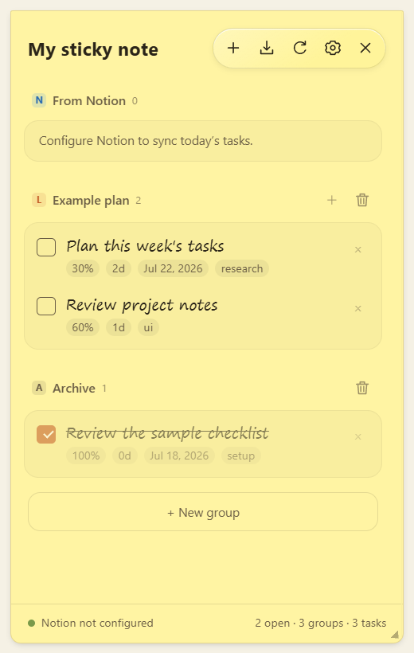
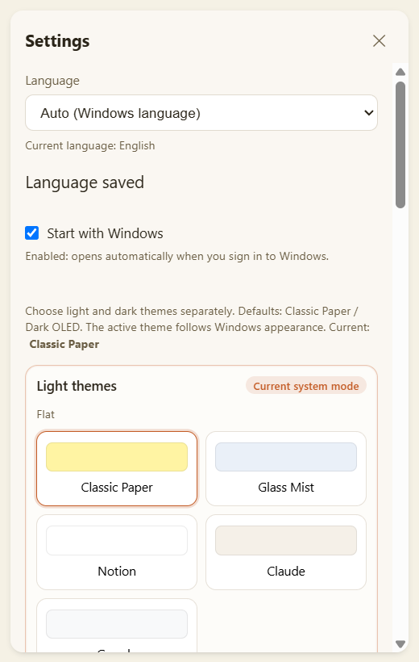

# Sticky Note

**English** · [简体中文](README.md) · [Download for Windows](https://github.com/AmadeusAN/notion_sticky_note/releases/latest)

An always-on-top Windows sticky note and task list with edge docking, local groups, Archive, and optional Notion database sync. Built with Tauri 2, React, and Rust. Local tasks work without Notion.

## Screenshots

| Main window (demo data) | Settings (demo configuration) |
|---|---|
|  |  |

[View Chinese screenshots](README.md)

## Install and upgrade

1. Requires **Windows 10/11 x64** and [Microsoft Edge WebView2 Runtime](https://developer.microsoft.com/microsoft-edge/webview2/). Windows 11 usually includes it; the installer may need internet access to obtain a missing runtime.
2. Download the NSIS installer (`*-setup.exe`) from [Releases](https://github.com/AmadeusAN/notion_sticky_note/releases/latest). The installer offers English and Simplified Chinese.
3. Installation is per current user. Choose a custom directory such as `C:\Apps\Sticky Note` or `D:\Apps\Sticky Note`. Writable folders do not require administrator permission. For protected locations such as `Program Files`, explicitly right-click the installer and select Run as administrator. It does not elevate automatically or offer an all-users installation mode.
4. Releases are **unsigned**. Windows SmartScreen may report an unknown publisher. Confirm the repository above and compare the release SHA-256 before continuing only if you trust the source. Do not disable security protection. A checksum checks file consistency; it is not a digital signature.

Before upgrading, exit normally from the tray, then run the new installer. Keep or change the installation directory; the installer retargets an existing startup entry without changing Windows startup approval or enabling a missing entry. User data is separate from the installation directory: normal upgrades retain SQLite tasks, groups, settings, and pending writes without deleting app data. Do not manually delete AppData. Data does not automatically transfer between Windows users.

## Everyday use

- **Language:** defaults to Auto, using the Windows display language: Chinese selects Simplified Chinese; other languages select English. Settings provides a persistent manual override. Installer language is independent of app language.
- **Local tasks:** use the top-right + button or bulk import. Only `；` and `;` split tasks; commas, internal newlines, order, and duplicates are retained. Preview before importing into an existing or newly created local group.
- **Archive:** completing a local task moves it to Archive; unchecking restores its original group. Deleting that group preserves already archived tasks, but they can no longer be restored there. Archive is cleared only after your explicit confirmation, never automatically.
- **Notion:** the fixed Notion group cannot be deleted; checking its tasks writes back remotely. Local creation, grouping, deletion, and Archive never create or delete Notion pages. Setup is below.
- **Window:** drag, resize, or dock against a screen edge. Only the exposed edge strip triggers expansion. × / Alt+F4 **hide to the tray, not quit**. Click the tray icon to restore; use its context menu to exit.
- **Settings:** themes, fonts, and edge effects preview immediately, with visible saving/error feedback and retry. Startup is off by default; its switch immediately applies to the current Windows user.
- **Keyboard:** Tab navigates; Escape cancels dialogs. In multiline task input, Ctrl+Enter submits and Enter inserts a newline; IME composition does not submit. Destructive operations require explicit confirmation.

Normal exit first saves received appearance changes and valid window state; failures offer retry, cancel, or explicit exit without unsaved settings. Force termination or power loss cannot guarantee unsaved settings. Optional online fonts contact Google Fonts; system fallback fonts are used when unavailable. See [third-party notices](THIRD-PARTY-NOTICES.txt).

## Connect Notion: first-time setup

This uses Notion's **official internal integration**, not a browser extension. Do not install an extension or provide your Notion password or browser cookies.

1. Open [Notion My Integrations](https://www.notion.so/my-integrations), create an **Internal Integration**, and select the target workspace. Enable **Read content**; checking tasks also requires **Update content**. The app does not require permission to create remote pages.
2. Copy the internal integration secret/token from its configuration page. Treat it like a password: paste it only into the local app's Settings, never into issues, screenshots, logs, or a public repository.
3. Open the **source database** in Notion. Under `··· → Connections`, add your integration (the exact menu wording may vary). Creating an integration alone does not grant database access.
4. Obtain the **Database ID**, not a view ID, containing-page ID, or newer Data Source ID. For a linked view, open its source database first and copy that link. These are structural examples only; replace angle-bracket fields:

   ```text
   https://www.notion.so/<workspace>/<DATABASE_ID>?v=<VIEW_ID>
   https://www.notion.so/<DATABASE_ID>?v=<VIEW_ID>
   ```

   `DATABASE_ID` is the 32-hex-character identifier in the database path, optionally hyphenated. The value after `?v=` is the view ID: do not use it.
5. Create the properties below. Enter your token, Database ID, and **actual property names** in Settings. Case, spaces, and option labels must match. If you have no Status column, **clear the Status property name**: it is enabled by default.
6. Select Test connection, then Save. The test checks database access only, not every property type, date filter, or write mapping. Check the task list using a generic demo row dated today.

Configuration is stored in local SQLite. Never upload the app database or a credential-bearing configuration as a public backup. Revoke/regenerate a leaked token in Notion, then update the app.

### Minimal schema and optional status

| Property | Notion type | Example |
|---|---|---|
| `Name` | Title (the built-in title column) | Demo task |
| `done?` | Checkbox | Unchecked |
| `Date` | Date | Today |

Keep these three default names in the app and **clear the Status property name** before saving for checkbox-only writes. Status cannot replace `done?`.

For linked status updates, add `Status` of type Status with `Not started` and `Done` options, and configure the same labels in the app. A Select column is also supported. Actual Chinese or other property/option names can be configured. Defaults are `Done` when complete and `Not started` when incomplete. Clearing the status property name, or the value for the current state, writes only the checkbox.

### Full property reference

The client uses Notion API `2022-06-28`, `/databases/{id}/query`. This is a Database API configuration, not a `data_source_id` configuration; arbitrary schemas are not supported without configuration.

| Purpose | Default name / built-in read aliases | Notion type | Requirement and direction |
|---|---|---|---|
| Title | `Name`; configurable; also recognizes a unique Title property | Title | Required, read-only; empty titles show `(untitled)` |
| Completion | `done?`; configurable | Checkbox | Required; query, read, write |
| Date | `Date`; configurable | Date, including ranges | Required; query/read only; undated tasks do not appear |
| Linked status | `Status`; configurable or cleared | Status, with Select compatibility | Optional, **enabled by default**; write-only |
| Progress | `progress line` / `progress` / `Progress` / `进度` | Rich text, Number, Select, Formula string/number | Optional, read-only |
| Remaining | `remain` / `Remain` / `剩余` / `Remaining` | Same as Progress | Optional, read-only |
| Tags | `tags` / `Tags` / `标签` | Multi-select | Optional, read-only; empty when absent |

Completion parsing also recognizes `done` / `Done` / `完成` / `Completed`; date parsing recognizes `date` / `日期` / `Deadline`. **These parsing fallbacks do not replace configured names in queries or PATCH requests.** Configure the real completion/date column names. Optional progress, remaining, and tags use only the built-in aliases above; they have no custom-name setting.

Rich text is concatenated in order; Select displays its option label. Ordinary Number values ≤ 1 display as percentages (`0.5 → 50%`, `1 → 100%`, `2 → 2`). Formula accepts only string/number; Formula Number stays numeric (`0.5 → 0.5`). Missing optional properties do not prevent sync.

### Date window, sync, and offline behavior

“Today” is determined using the local timezone. Sync **does not fetch the entire database**:

- Tasks starting today and covering today, whether complete or incomplete.
- Incomplete tasks starting within the previous **60 days, inclusive**, whose date range covers today; the end date includes today.
- Undated tasks, future starts, starts earlier than the window, and ended ranges do not appear. Completed tasks starting on an earlier day may leave the window.
- Date-time strings use their first 10 API characters as the date, without converting the timestamp first. Ranges display as `start → end`.

The native worker is the only sync scheduler: with full configuration, the first pull starts about 2 seconds after launch, then about 30 seconds after each full cycle finishes, including while hidden in the tray. Overlapping manual/periodic requests are merged. Without configuration, it waits for configuration changes instead of polling the network.

Checking a Notion task saves its local checkbox and durable pending intent together, then writes the checkbox/configured Status sequentially. Network or permission failures retain pending writes across restarts. Repeated changes to the same page retain the newest intent. Pulls use remote titles, dates, and other fields while preserving local checkboxes for pending pages. Without a complete token/ID, cached Notion tasks remain but their checkboxes are disabled; local tasks still work.

Changing databases, clearing database identity, or changing write mappings with pending writes requires explicit confirmation to discard them. Cancel leaves configuration unchanged; new pending changes during confirmation require confirmation again. Replacing only the token can restore access. Unverified legacy records are retained and checked against their source database, never silently dropped or sent to a different database.

The footer reports sync state, last full success, and pending counts; loading local data is not remote success. Any failed page or malformed response retains the previous cache rather than applying a partial snapshot. Status retries as Select only after an explicit matching Notion property-type validation error. HTTP 429 respects a valid `Retry-After`; otherwise it waits for a later approximately 30-second cycle. Manual sync cannot bypass that delay. Connection timeout is 5 seconds; total request timeout is 20 seconds.

### Notion FAQ

**Connection works but no tasks appear?** Test connection only performs a database GET. Check the date window and actual completion/date names and types. Start with a generic incomplete row dated today. Optional progress, remaining, and tags are not filters.

**Database not found / permission denied?** Check the workspace, source Database ID, database Connections, and integration Read content permission. Do not use a view ID, ordinary page ID, or Data Source ID.

**Checkbox remains pending / write fails?** Check Update content permission, Checkbox type, Status/Select type, and exact existing option labels. Clear the Status property name if the database has no status column. Fix credentials or permissions, then retry; do not discard pending writes merely to hide an error.

**Why did an older or completed multiday task disappear?** It may no longer meet the 60-day/today window; that does not mean it was deleted. Notion still owns the remote page.

**Are local tasks uploaded?** No. The app reads Notion content and only updates existing pages' checkbox/configured Status. Local groups, deletion, and Archive do not create, delete, or archive remote pages.

## Build from source

Development additionally requires Node.js 20+, Rust stable (MSVC), Visual Studio Build Tools with Desktop development with C++, and a Windows SDK. Use the checked-in lockfiles:

```powershell
npm ci
npm run tauri:dev
# Production NSIS installer; beforeBuildCommand also builds the frontend
npm run tauri:build -- --bundles nsis -- --locked
```

Output: `src-tauri/target/release/bundle/nsis/`. Behavior checks: `npm test` and `cargo test --locked --manifest-path src-tauri/Cargo.toml --lib`. Notion HTTP fixtures use fictional credentials and a local server, never a real account.

The manual GitHub Actions **Windows release build** workflow uploads NSIS, third-party notices, and SHA-256 build artifacts; it **does not publish a GitHub Release**. A maintainer reviews them before publication. Open `debug/edge_effects_preview.html` for an offline preview of shared paper/glass materials; `npm run icons` regenerates icons from repository SVGs. The existing `debug/app/latest.exe` development workflow can use `debug/sync_latest.bat`; do not register an isolated audit executable for startup.

Performance depends on hardware, WebView2, DPI, theme, and task count. No fixed memory usage or unmeasured performance improvement is promised.

## License

Original project code and icons are licensed under [MIT](LICENSE), copyright AmadeusAN and contributors. Dependencies, fonts, and platform runtimes retain their own licenses; the project MIT license does not relicense all assets. See [THIRD-PARTY-NOTICES.txt](THIRD-PARTY-NOTICES.txt). This project is not affiliated with or endorsed by Notion.
