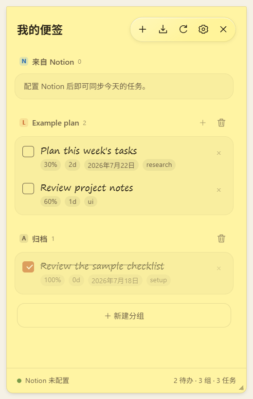
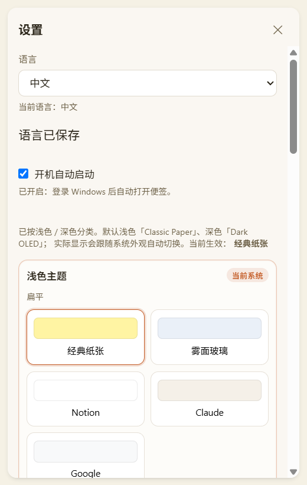

# Sticky Note

[English](README.en.md) · **简体中文** · [下载 Windows 安装包](https://github.com/AmadeusAN/notion_sticky_note/releases/latest)

Windows 桌面便签与待办：置顶、贴边收起、本地分组和 Archive，也能连接 Notion 数据库。基于 Tauri 2、React 和 Rust；不连接 Notion 也可使用本地任务。

| 主面板（演示数据） | 设置（演示配置） |
|---|---|
|  |  |

[查看英文界面截图](README.en.md#screenshots)

## 安装与升级

1. 系统要求：**Windows 10/11 x64** 和 [Microsoft Edge WebView2 Runtime](https://developer.microsoft.com/microsoft-edge/webview2/)。Windows 11 通常已有；缺少时安装程序可能需要联网获取运行时。
2. 从 [Releases](https://github.com/AmadeusAN/notion_sticky_note/releases/latest) 下载 NSIS 安装程序（`*-setup.exe`）。安装语言可选 English / 简体中文。
3. 按当前用户安装；可选择 `C:\Apps\Sticky Note` 或 `D:\Apps\Sticky Note` 等自定义目录。所选目录须可写，普通可写目录不要求管理员权限。安装到 `Program Files` 等受保护位置时，需右键安装程序选择“以管理员身份运行”；安装程序不自动提权，也不提供所有用户安装模式。
4. 此项目发布的是**未签名**安装包，Windows SmartScreen 可能提示“未知发布者”。先确认来自上述仓库、核对发布页 SHA-256；仅在信任来源后选择继续。不要关闭系统安全防护。校验和只能核对文件一致性，不能替代数字签名。

升级前从托盘正常退出，再运行新安装包。可沿用或更改安装目录；安装程序会更新已有的自启动路径，保留 Windows 的启动批准状态，不会擅自开启自启动。安装目录与用户数据分离；正常升级保留 SQLite 中的任务、分组、配置和待回写记录，不删除应用数据。不要手动删除 AppData；跨 Windows 用户的数据不会自动迁移。

## 日常使用

- **语言**：默认“跟随系统”，按 Windows 显示语言自动选择中文或英文；中文系统使用简体中文，其他语言使用英文。设置中可手动选择并保存；安装程序语言与应用语言独立。
- **本地任务**：用右上角 ＋ 创建任务，用导入按钮批量添加；仅 `；` / `;` 分隔，逗号、段内换行、顺序与重复内容保留。支持预览后导入已有组或同时创建新组。
- **Archive**：本地任务完成后归档，取消完成回原组。原组删除时已归档任务仍保留，但无法恢复到该组。归档只由你确认清理，不会自动删除。
- **Notion**：固定的 Notion 组不可删除，勾选会回写远端；本地创建、分组、删除和 Archive 不会创建或删除 Notion 页面。连接方法见下文。
- **窗口**：拖动、缩放、贴到屏幕边缘收成边条；只有鼠标进入实际露出的边条才展开。× / Alt+F4 **隐藏到托盘，不退出**；单击托盘恢复，右键菜单退出。
- **设置**：主题、字体、贴边特效即时预览，保存中或失败会显示反馈；失败可重试。自启动默认关闭，开关对当前 Windows 用户即时生效。
- **键盘**：Tab 导航、Escape 取消对话框；多行任务输入用 Ctrl+Enter 提交，Enter 换行，输入法组合期间不提交。删除操作需明确确认。

正常退出会先保存已接收的外观与有效窗口状态；失败可重试、取消或明确放弃未保存设置退出。强制结束进程／断电不能保证尚未落库的设置。可选在线字体会访问 Google Fonts；网络不可用时使用系统后备字体，详情见[第三方声明](THIRD-PARTY-NOTICES.txt)。

## 连接 Notion：首次配置

这是 Notion **官方内部集成（Internal Integration）**，不是浏览器扩展；不需要安装插件，也不要提供 Notion 登录密码或浏览器 Cookie。

1. 登录 [Notion My Integrations](https://www.notion.so/my-integrations)，新建内部集成，选择目标工作区。在权限中允许 **Read content**；如需勾选回写，还需 **Update content**。本应用不需要创建远端页面的权限。
2. 在集成配置页复制内部集成密钥（可能显示为 Internal Integration Secret / Token）。它等同于密码：仅粘贴到本机应用设置，不要发到 Issue、截图、日志或公开仓库。
3. 打开 Notion **源数据库**，在 `··· → Connections / 连接` 中添加刚建的集成（不同 Notion 界面可能显示“添加连接”）。只有创建集成但没有授权该数据库，仍无法访问。
4. 从源数据库链接取 **Database ID**，不是视图 ID、普通容器页面 ID 或新版 Data Source ID。链接视图请先打开源数据库，再复制链接。以下仅为结构示例，尖括号需替换：

   ```text
   https://www.notion.so/<workspace>/<DATABASE_ID>?v=<VIEW_ID>
   https://www.notion.so/<DATABASE_ID>?v=<VIEW_ID>
   ```

   `DATABASE_ID` 是数据库路径中 32 位十六进制标识（可带连字符）；`?v=` 后面的是视图，不要填入。
5. 按下表创建属性，在便签设置中输入 Token、Database ID 及**实际属性名称**。名称大小写、空格和选项文字都要一致。没有 Status 列时，务必**清空 Status 属性名**，因为它默认开启。
6. 点“测试连接”，再点“保存”。测试仅验证数据库可访问，不保证日期过滤、所有属性类型或回写已正确；用日期为今天的通用示例行检查列表。

配置保存在本机 SQLite；不要把应用数据库或带密钥的配置作为备份上传到公开位置。密钥泄露后应在 Notion 撤销／重新生成，再更新应用。

### 最小建表与可选状态

| 属性名 | Notion 类型 | 示例 |
|---|---|---|
| `Name` | Title（数据库自带标题列） | 示例任务 |
| `done?` | Checkbox | 未勾选 |
| `Date` | Date | 今天 |

在应用中保留这三个默认名称，**清空 Status 属性名**后保存，即可只回写 checkbox。Status 不能代替 `done?`。

需要状态联动时新增 `Status`（Status 类型），准备 `Not started` 和 `Done` 选项，并在应用设置中填写相同文字；也兼容 Select 列。可改成实际中文属性和选项名。默认完成值是 `Done`、未完成值是 `Not started`；清空状态属性名或本次状态对应的值时仅写 checkbox。

### 完整属性参考

客户端使用 Notion API `2022-06-28` 的 `/databases/{id}/query`。这是 Database API 配置，不是 `data_source_id` 配置，不承诺任意数据库零配置适配。

| 用途 | 默认名／内置读取别名 | Notion 类型 | 必需与方向 |
|---|---|---|---|
| 标题 | `Name`，可配置实际名；也能识别唯一 Title | Title | 必需，只读；空标题显示 `(untitled)` |
| 完成 | `done?`，可配置实际名 | Checkbox | 必需；查询、读取、回写 |
| 日期 | `Date`，可配置实际名 | Date，可有起止区间 | 必需；查询、只读；无日期不显示 |
| 联动状态 | `Status`，可配置或清空 | Status，兼容 Select | 可选，**默认开启**，只回写 |
| 进度 | `progress line` / `progress` / `Progress` / `进度` | Rich text、Number、Select、Formula 的 string/number | 可选，只读 |
| 剩余 | `remain` / `Remain` / `剩余` / `Remaining` | 同进度 | 可选，只读 |
| 标签 | `tags` / `Tags` / `标签` | Multi-select | 可选，只读；缺失为空 |

完成读取还兼容 `done` / `Done` / `完成` / `Completed`；日期读取还兼容 `date` / `日期` / `Deadline`。**这些是解析兜底，不会替换 query / PATCH 的配置名**：必须在设置中填写真实完成列和日期列。可选进度、剩余、标签仅按上述内置别名识别，没有自定义名称设置。

富文本按顺序拼接，Select 显示选项名；普通 Number ≤ 1 按百分比显示（`0.5 → 50%`、`1 → 100%`、`2 → 2`）。Formula 仅读取 string/number，Formula Number 按数字显示（`0.5 → 0.5`）。可选字段缺失不影响同步。

### 日期窗口、同步与离线

同步按本机时区确定“今天”，**不是拉取全库**：

- 今天开始、日期覆盖今天的任务，无论是否完成。
- 往前 **60 天（含边界）**内开始、尚未完成、日期区间覆盖今天的任务；区间结束日含今天。
- 无日期、未来开始、早于窗口开始、已结束的任务不显示；过去开始的跨日任务完成后也可能离开窗口。
- 日期时间按 API 原字符串前 10 位作为日期，不先做时区转换；区间显示为 `开始 → 结束`。

原生后台是唯一同步调度者：配置完整时启动约 2 秒后首次拉取，完整轮次结束约 30 秒后再拉取；隐藏到托盘仍同步。手动与周期请求合并；未配置时等待配置变更，不进行同步网络轮询。

Notion 勾选先把本地结果与持久待写意图一起保存，随后顺序回写 checkbox / 配置的 Status。断网或权限错误不会丢弃队列，重启后可继续；同页连续操作保留最新意图。拉取使用远端标题、日期等数据，尚待回写的页面保留本地 checkbox。无完整 Token / ID 时保留缓存但禁用 Notion 勾选，本地任务照常使用。

有待写记录时切换数据库、清除身份或改变回写属性需明确确认放弃；取消不变，确认期间又有新操作会重新确认。只更换 Token 可用于恢复访问。来源未确认的旧记录会保留并核对所属数据库，不静默删除或发到其他库。

底部显示同步状态、上次完整成功时间和待回写数量；本地读取不算远端成功。任一分页失败或结构错误均保留旧缓存，不用半份结果覆盖。Status 写入只在 Notion 明确返回对应 Select 类型验证错误时重试 Select。429 按有效 `Retry-After` 延后；没有有效值时等待后续约 30 秒轮次，手动同步不能绕过。连接超时 5 秒，单请求总超时 20 秒。

### Notion 常见问题

**连接成功但没有任务？** “测试连接”仅 GET 数据库。检查日期窗口、完成／日期列的真实名称与类型；先放一条今天日期、未完成的示例行。可选进度、剩余、标签不是筛选条件。

**找不到数据库或没有权限？** 检查工作区、源 Database ID、数据库 Connections 和集成 Read content 权限；不要使用视图、普通页面或 Data Source ID。

**勾选后待回写／失败？** 检查 Update content 权限、Checkbox 类型、Status / Select 类型与已有选项的精确名称；没有状态列就清空属性名。修复 Token 或权限后重试，不要为了消除提示直接丢弃待写记录。

**为什么旧任务、已完成跨日任务消失？** 它们可能不符合上述 60 天／今天窗口，不等于被删除。远端页面仍由 Notion 管理。

**本地任务会上传到 Notion 吗？** 不会。应用读取 Notion 内容，仅回写已有页面的 checkbox 与配置的 Status；本地组、删除和 Archive 不创建、删除或归档远端页面。

## 从源码构建

开发环境另需 Node.js 20+、Rust stable（MSVC）、Visual Studio Build Tools 的“使用 C++ 的桌面开发”及 Windows SDK。使用仓库锁文件：

```powershell
npm ci
npm run tauri:dev
# 生产 NSIS 安装包，前端由 beforeBuildCommand 一并构建
npm run tauri:build -- --bundles nsis -- --locked
```

输出：`src-tauri/target/release/bundle/nsis/`。行为检查：`npm test` 和 `cargo test --locked --manifest-path src-tauri/Cargo.toml --lib`。Notion HTTP fixture 使用虚构凭据和本机服务，不写真实账户。

GitHub Actions 的手动 **Windows release build** 工作流只生成 NSIS、第三方声明与 SHA-256 构建产物，**不自动发布 Release**；发布者检查后再上传。`debug/edge_effects_preview.html` 可离线预览共享纸页／玻璃材质；`npm run icons` 从仓库 SVG 重新生成图标。保留 `debug/app/latest.exe` 的开发工作流可用现有 `debug/sync_latest.bat` 更新，勿把隔离测试程序设为自启动。

性能随机器、WebView2、DPI、主题和任务量变化；本项目不承诺固定内存占用或未经测量的性能提升。

## 许可

项目原创代码与图标使用 [MIT License](LICENSE)，版权所有 AmadeusAN 及贡献者。依赖、字体及平台运行时各自适用其许可证，并非全部资产都以本项目 MIT 重新授权；见 [THIRD-PARTY-NOTICES.txt](THIRD-PARTY-NOTICES.txt)。本项目与 Notion 无隶属或背书关系。

