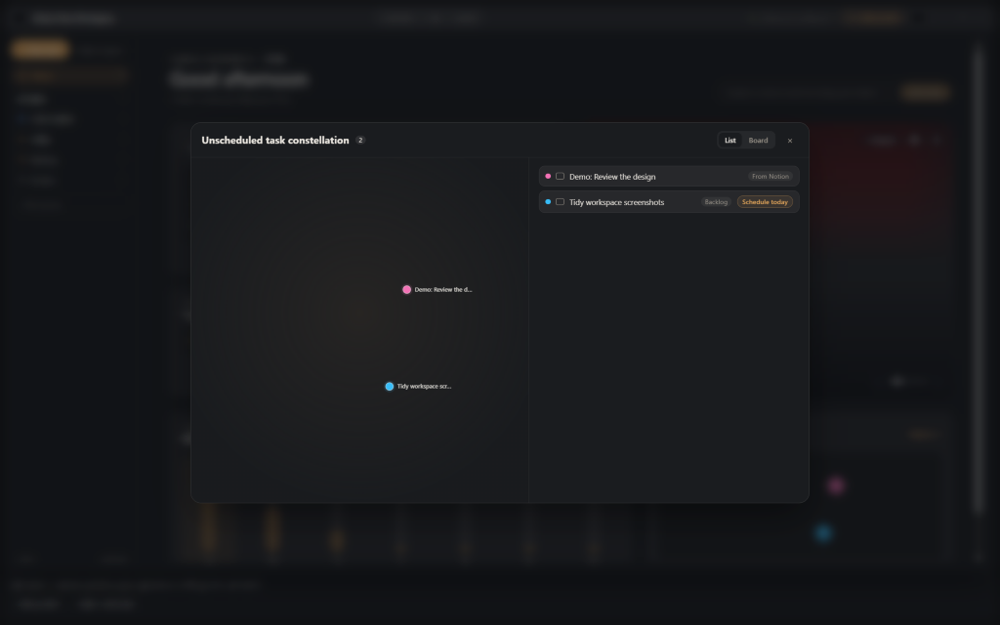
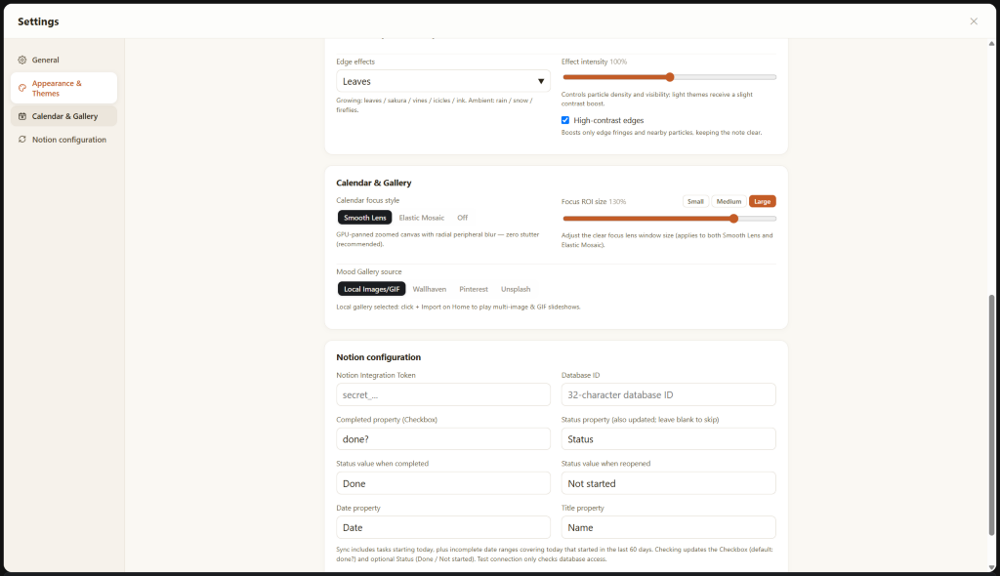
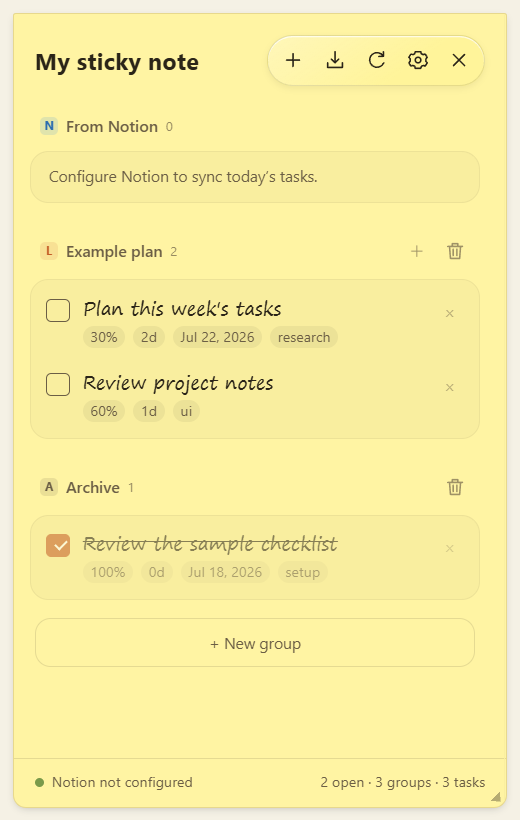
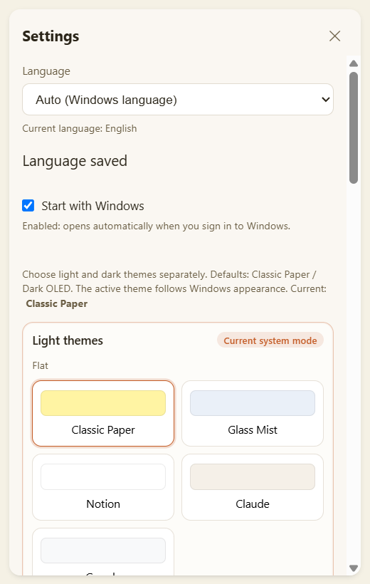

# Sticky Note

**English** · [简体中文](README.zh-CN.md) · [Download Windows Installer](https://github.com/AmadeusAN/notion_sticky_note/releases/latest)

A dual-mode Windows desktop productivity app: dock it as a translucent, always-on-top **Sticky Note** on your screen edge, or expand into a full-screen **Desktop Workspace** featuring an Editorial Home dashboard, Focus-Lens Calendar, animated Unscheduled Constellation graph, Kanban Board, and optional two-way Notion sync. Built with Tauri 2, React, and Rust.

## Screenshots

### Workspace Home


### Calendar, Constellation Graph, Board & Desktop Settings

| Interactive Calendar (`Smooth Focus Lens` & Drag-to-Resize) | Unscheduled Task Constellation (`List` / `Board`) |
|---|---|
|  |  |
| **Kanban Board & Task Inspector** | **Desktop Settings (`>= 720px` Two-Pane Layout)** |
|  |  |

### Sticky Note Mode (Compact & Docked)

| Classic Paper | Dark Layered (`Ink Stack`) | Compact Settings |
|---|---|---|
|  |  |  |

[View Chinese documentation &amp; sticky screenshots](README.zh-CN.md)

## Features

- **Dual-Mode Window (`Sticky Mode` ↔ `Workspace Mode`):** Keep a sleek floating sticky note pinned above other windows and tucked cleanly into any screen edge (native 60Hz / 144Hz / 180Hz+ smooth slide-out), or expand with one click into a responsive wide desktop workspace.
- **Editorial Home Dashboard (`All tasks`):** Features a live clock greeting, quick capture bar, Today's Focus ring, Tomorrow Preview, interactive 7-Day Rhythm bars, and animated **Unscheduled Task Constellation** cluster modal.
- **Mood Gallery (Local GIF & Online Feeds):** Display looping local PNG/JPG/WebP/GIF slideshows stored offline in IndexedDB, or pull randomized visual feeds from **Wallhaven** (with customizable add/remove keyword tags), public **Pinterest** board RSS feeds, and **Unsplash**, with automatic Windows system proxy / custom proxy support and click-to-open source links.
- **Interactive Calendar (`Month` / `Week` / `Day`):**
  - **Dynamic Focus Styles:** Choose between **Smooth Lens** (GPU-panned zoomed canvas + radial blur), **Elastic Mosaic**, or **Off**, plus an adjustable **Focus ROI Size** (`65%–145%`).
  - **Fast Direct Manipulation:** Drag unscheduled tasks onto days or time slots, extend or shrink multi-day event spans horizontally directly from the right-edge arrow (`→`) handle on any card, and resize timed blocks vertically in Week/Day views.
- **Kanban Board, Task Inspector & Apple-Style Reordering:** Organize custom groups and tasks via physics-smooth pointer drag-and-drop sorting, inspect/edit schedules in the slide-over inspector, and bulk-import items separated by `;` or `；`.
- **Windows Reminders & Instant Status Toasts:** Set preset or custom date/time notifications backed by a Rust background reminder engine, with clear toast feedback on every state change.
- **15 Themes & 8 Edge Effects:** Independent Light and Dark theme presets (Paper, Glass, Notion, Claude, Google, Dark OLED, layered cards, and animated shaders) synced to Windows appearance, paired with growing and weather edge effects (leaves, sakura, vines, icicles, ink, rain, snow, fireflies).
- **Optional Two-Way Notion Sync & Tray Residency:** Pull today's tasks and active multi-day tasks from Notion with offline retry queuing; closing (`×` / `Alt+F4`) hides to the system tray, with bilingual English / Simplified Chinese UI and optional **Start with Windows**.

## Install & Upgrade

1. Download the latest `*-setup.exe` installer from [Releases](https://github.com/AmadeusAN/notion_sticky_note/releases/latest) (Windows 10/11 x64; requires WebView2 Runtime, built into Windows 11).
2. Double-click to install for the current user (choose English or Simplified Chinese during setup).
3. **Upgrading:** Quit the running app from the tray icon menu first, then run the new `*-setup.exe`. The installer automatically detects your previous installation directory for an in-place update while preserving all local tasks, groups, themes, and Notion settings in SQLite (`AppData`).

> **Note:** Releases are currently unsigned, so Windows SmartScreen may show an "Unknown publisher" warning. Confirm the download comes from this repository and verify the hash against `SHA256SUMS.txt` on the release page before continuing.

## Connect Notion (Optional)

Sticky Note uses Notion's official **Internal Integration** API (no browser extensions or passwords required):

1. Create an integration at [Notion My Integrations](https://www.notion.so/my-integrations) with **Read content** (and **Update content** if you want checkbox sync-back), then copy its **Internal Integration Secret**.
2. Open your source database in Notion → `···` → **Connections** → add your integration.
3. Copy the 32-character **Database ID** from the database URL (`https://www.notion.so/<DATABASE_ID>?v=<VIEW_ID>` — ignore everything after `?v=`).
4. Paste the token, Database ID, and exact property names in **Settings**, then click **Test connection** and **Save**.

### Minimal Notion Database Schema

| Property | Notion Type | Purpose |
|---|---|---|
| `Name` | Title | Task title (required, read-only) |
| `done?` | Checkbox | Completion state (required, two-way sync) |
| `Date` | Date | Task date or range (required; tasks without a date are hidden) |
| `Status` | Status or Select | Optional linked status (`Not started` / `Done` by default; clear the field name if unused) |

<details>
<summary>Optional metadata properties &amp; sync details</summary>

- **Read-only metadata aliases:** Automatically displays `Progress` (`progress line` / `progress` / `Progress` / `进度`), `Remain` (`remain` / `Remain` / `剩余` / `Remaining`), and `Tags` (`tags` / `Tags` / `标签`).
- **Date window:** Syncs tasks covering today (local timezone) and incomplete multi-day tasks started within the past 60 days.
- **Sync cadence:** Polls ~2s after launch and ~30s after each completed cycle (even while hidden in the tray). Local groups, deletions, and Archive never create or delete pages in Notion.

</details>

## Build from Source

Requires Node.js 20+, Rust stable (MSVC), and Visual Studio Build Tools (Desktop development with C++):

```powershell
npm ci
npm run tauri:dev

# Run tests
npm test
cargo test --locked --manifest-path src-tauri/Cargo.toml --lib

# Build NSIS installer -> src-tauri/target/release/bundle/nsis/
npm run tauri:build -- --bundles nsis -- --locked
```

## License

Code and icons are licensed under the [MIT License](LICENSE). Third-party dependencies, fonts, and runtime notices are listed in [THIRD-PARTY-NOTICES.txt](THIRD-PARTY-NOTICES.txt). Not affiliated with Notion.
