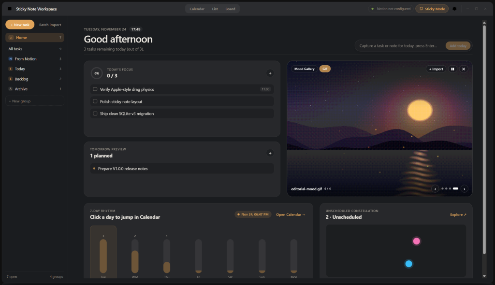
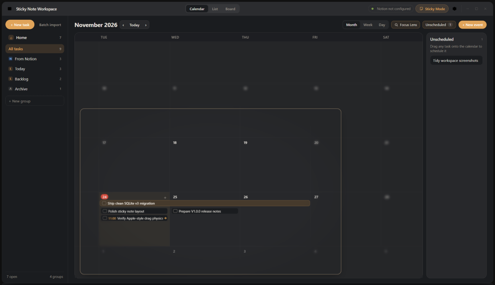
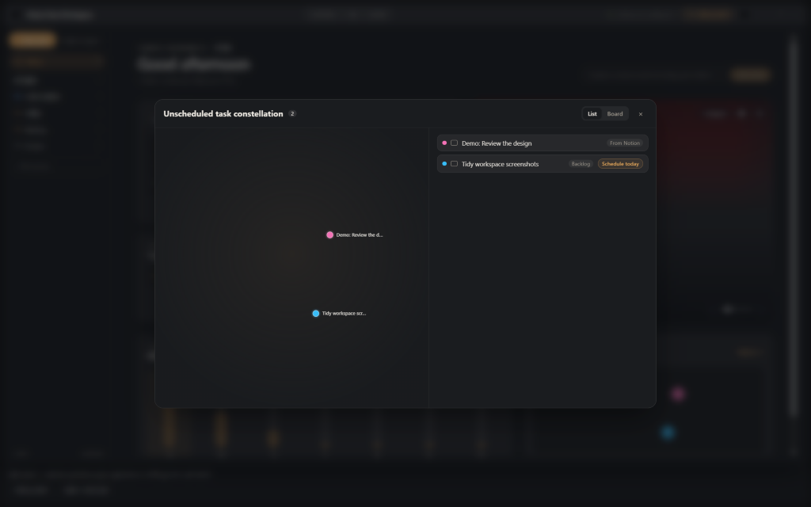
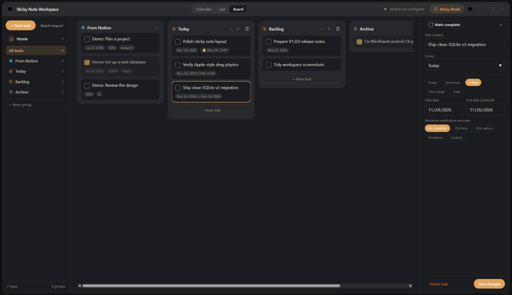
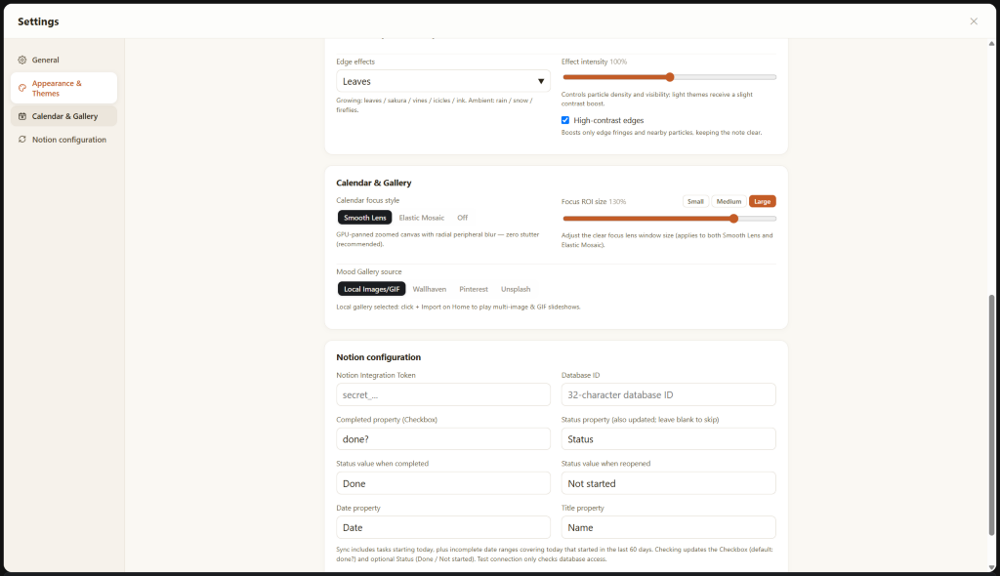
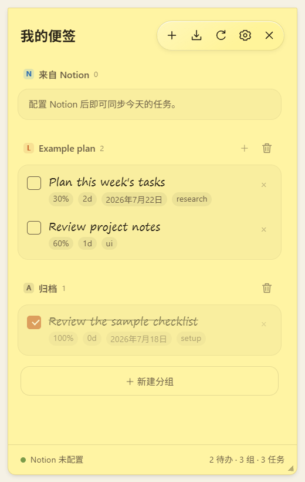
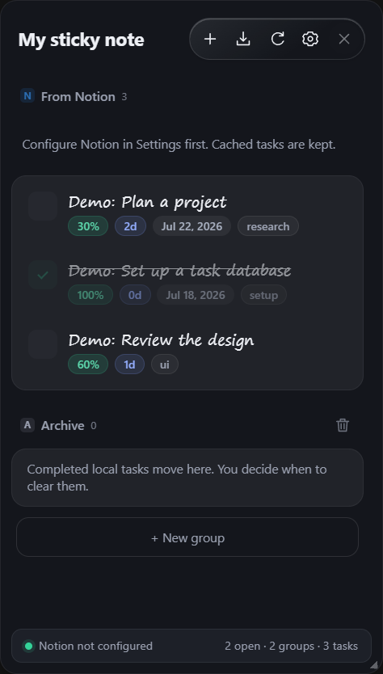
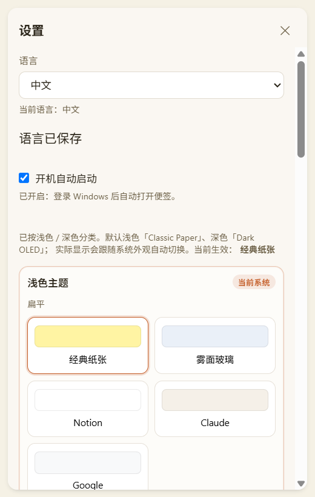

# Sticky Note

[English](README.md) · **简体中文** · [下载 Windows 安装包](https://github.com/AmadeusAN/notion_sticky_note/releases/latest)

双形态 Windows 桌面效率工具：平时可作为半透明置顶**桌面便签**丝滑贴边收起，一键即可展开为完整**桌面工作台（Workspace）**，内置杂志风 Home 主面板、动态聚焦日历、未排期任务星图、多列看板与详情抽屉，并支持可选的 Notion 数据库双向同步。基于 Tauri 2、React 和 Rust 构建。

## 界面预览

### 桌面工作台 Home 主面板


### 动态聚焦日历、未排期星图、看板与双栏设置

| 交互式月历（丝滑聚焦透镜 & 右边缘拖拽改期） | 未排期任务星图（动态关系图谱 + 列表/看板） |
|---|---|
|  |  |
| **分组看板与右侧任务详情抽屉** | **桌面端双栏设置面板** |
|  |  |

### 桌面便签形态（轻量置顶 & 贴边收起）

| 经典纸张主题（中文） | 深色卡片主题（Ink Stack） | 便签模式设置（中文） |
|---|---|---|
|  |  |  |

## 核心功能

- **双形态窗口无缝切换（便签模式 ↔ 桌面工作台）：** 轻量状态下可始终置顶并吸附屏幕边缘（原生适配 60Hz / 144Hz / 180Hz+ 高刷丝滑滑出）；需要规划与复盘时一键展开为宽屏生产力工作台。
- **极简杂志风 Home 主面板（All tasks）：** 集成实时问候与时钟、顶部快速捕获栏、今日聚焦进度环、明日预览、可点击跳转日历的未来 7 日柱状图，以及随时间轻轻浮动的**未排期任务星图**弹窗。
- **灵感画廊（本地 GIF 动图 & 多在线图源）：** 支持直接导入本地 PNG/JPG/WebP/GIF 进行离线多图/动图轮播（IndexedDB 持久化），或随机拉取 **Wallhaven**（支持自定义增删关键词标签）、**Pinterest** 公开画板 RSS 与 **Unsplash**，自动适配 Windows 系统代理 / 手动代理，并支持点击直达原图来源。
- **交互式日历（月 / 周 / 日视图）：**
  - **动态聚焦与 ROI 尺寸调节：** 内置**丝滑透镜（Smooth Lens）**（GPU 平移放大画布 + 径向周边模糊）与**动态拼花（Elastic Mosaic）**，可在设置中自由切换并在 `65%–145%` 之间调节聚焦框大小。
  - **所见即所得拖拽操作：** 未排期任务拖入格子即可排期；悬停任意可编辑事件卡片右边缘出现 `→` 手柄，横向拖跨日期格即可实时拉伸或缩短跨天日程，无需打开表单。
- **看板视图、详情检查器与丝滑排序：** 支持物理感拖拽重排自定义分组与任务顺序、`；`/`;` 批量导入、右侧统一管理起止日期与提醒设置。
- **Windows 本地提醒与全局状态提示：** Rust 后台定时检查并发起系统通知，所有任务、日程与设置状态变更均有清晰的全局 Toast 反馈。
- **15 套主题与 8 种边缘特效：** 浅色/深色主题独立配置并随系统外观自动切换（纸张、玻璃、Notion/Claude/Google 风格、Dark OLED、分层卡片、动态流光），搭配落叶、樱花、藤蔓、冰棱、墨迹、雨滴、飘雪与萤火虫特效。
- **可选 Notion 双向同步与托盘常驻：** 断网自动排队重试；关闭窗口自动隐藏至系统托盘，支持简中/英文双语与开机自启。

## 安装与升级

1. 从 [Releases](https://github.com/AmadeusAN/notion_sticky_note/releases/latest) 下载最新的 `*-setup.exe` 安装包（支持 Windows 10/11 x64；需 WebView2 Runtime，Win11 通常已内置）。
2. 双击运行即可按当前用户安装（安装向导支持简体中文与英文）。
3. **版本升级：** 升级前先右键系统托盘图标选择退出，再直接运行新版 `*-setup.exe`。安装程序会自动识别之前的安装目录完成原位更新，并完整保留保存在 SQLite（`AppData`）中的所有本地任务、分组、主题与 Notion 配置。

> **提示：** 安装包目前为未签名构建，Windows SmartScreen 可能会提示“未知发布者”。请确认下载来源为本仓库，并在核对 Release 页面附带的 `SHA256SUMS.txt` 后再继续运行。

## 连接 Notion（可选）

使用 Notion 官方 **Internal Integration（内部集成）** 接口，无需浏览器插件，也无需提供账号密码：

1. 前往 [Notion My Integrations](https://www.notion.so/my-integrations) 新建内部集成，勾选 **Read content**（如需勾选回写任务状态，还需勾选 **Update content**），复制生成的 **Secret / Token**。
2. 在 Notion 中打开源数据库 → 右上角 `···` → **Connections（连接）** → 添加刚才创建的集成。
3. 从源数据库链接中提取 32 位 **Database ID**（格式如 `https://www.notion.so/<DATABASE_ID>?v=<VIEW_ID>`，忽略 `?v=` 后的视图参数）。
4. 在应用**设置**中填入 Token、Database ID 及对应的属性名称，点击**测试连接**并**保存**。

### 最小 Notion 数据库结构

| 属性名 | Notion 类型 | 说明 |
|---|---|---|
| `Name` | Title | 任务标题（必需，只读） |
| `done?` | Checkbox | 完成状态（必需，支持勾选回写） |
| `Date` | Date | 任务日期或起止区间（必需，无日期的任务不显示） |
| `Status` | Status 或 Select | 可选联动状态（默认 `Not started` / `Done`，无此列请清空设置项） |

<details>
<summary>更多可选字段别名与同步规则</summary>

- **只读辅助字段：** 自动识别 `Progress`（`progress line` / `progress` / `Progress` / `进度`）、`Remain`（`remain` / `Remain` / `剩余` / `Remaining`）以及 `Tags`（`tags` / `Tags` / `标签`）。
- **日期窗口：** 按本机时区拉取覆盖今天的任务，以及过去 60 天内开始且未完成的跨日任务，避免拉取整库造成冗余。
- **同步节奏：** 启动约 2 秒后首次拉取，之后每轮完成约 30 秒刷新一次（隐藏到托盘仍持续同步）。本地创建、分组、删除和归档均不会创建或删除 Notion 页面。

</details>

## 从源码构建

开发环境需安装 Node.js 20+、Rust stable（MSVC）及 Visual Studio C++ 桌面开发工具链：

```powershell
npm ci
npm run tauri:dev

# 运行测试
npm test
cargo test --locked --manifest-path src-tauri/Cargo.toml --lib

# 构建 NSIS 安装包 -> src-tauri/target/release/bundle/nsis/
npm run tauri:build -- --bundles nsis -- --locked
```

## 开源许可

项目原创代码与图标基于 [MIT License](LICENSE) 开源；第三方依赖与字体许可详见 [THIRD-PARTY-NOTICES.txt](THIRD-PARTY-NOTICES.txt)。本项目与 Notion 官方无隶属或背书关系。
