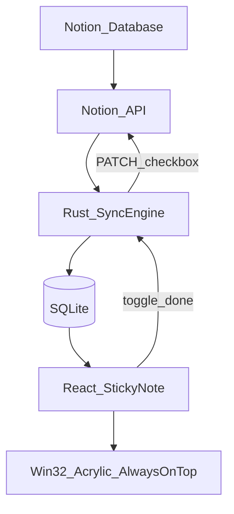

# Windows 写实便签 + Notion 同步开发计划

## 现状与目标

工作区目前仅有 [ref.md](ref.md)，无源码脚手架。交付物是 **Windows 桌面便签应用**（非 VS Code 插件）；其中的「Notion 插件」指 **Notion Integration + 应用内连接器**。

核心能力对齐 ref.md §10：真实纸质便签外观、始终置顶/可缩放/可拖动、重力弹簧拖动、Acrylic 模糊、多主题、Notion 双向同步、SQLite 离线缓存、内存 <200MB。

## 技术决策（已锁定）


| 项              | 选型                                                      | 理由                            |
| -------------- | ------------------------------------------------------- | ----------------------------- |
| 桌面壳            | **Tauri 2.0** + WebView2                                | 满足 <200MB；原生窗口控制              |
| UI             | React + TypeScript + Vite + Zustand                     | 与 ref 一致；轻量状态                 |
| 动画             | CSS transform/opacity + 自研弹簧；必要时用 Framer Motion 做 UI 过渡 | 单便签不引入 Matter.js，降低内存与复杂度     |
| 系统层            | Rust + `windows` crate                                  | 置顶、无边框、Acrylic                |
| 缓存             | SQLite（`rusqlite`）                                      | 离线 + 防 Notion 延迟              |
| Notion 鉴权（MVP） | **Internal Integration Token** + Database ID（设置页粘贴）     | 比 OAuth 快落地；Phase 后续可加 OAuth  |
| 同步（MVP）        | **轮询 30s** + 本地勾选即时 PATCH                               | 不做云端 Webhook/WebSocket（高级版另议） |
| 打包             | Tauri bundler（NSIS/MSI）                                 | 先可安装再谈自动更新                    |





## 目标仓库结构

在仓库根目录初始化（不必再套一层 `sticky-note-app/`）：

```
Plugin_sticky_note/
├── src/                    # React
│   ├── components/         # StickyNote, TaskItem, ThemeSelector, Settings
│   ├── stores/             # taskStore, settingsStore
│   ├── physics/            # spring.ts（拖动惯性）
│   ├── themes/             # paper / glass / dark
│   └── App.tsx
├── src-tauri/
│   ├── src/
│   │   ├── main.rs / lib.rs
│   │   ├── window.rs       # 置顶、透明、Acrylic
│   │   ├── notion.rs       # API client
│   │   ├── database.rs     # SQLite
│   │   └── sync.rs         # 轮询 + 冲突合并
│   ├── Cargo.toml
│   └── tauri.conf.json
└── ref.md
```

## Notion 数据模型（对齐截图字段）

本地 `tasks` 表与 Notion 属性映射：

- `title` ← Title
- `completed` ← `done`（checkbox）
- `progress` / `remain` / `date` / `tags`（只读展示为主；勾选只写 `done`）
- `notion_id`、`updated_time`（同步游标 / 冲突）

设置表：`notion_token`、`database_id`、窗口尺寸/位置、当前主题。Token 仅存本地，不入库到版本控制。

冲突策略（MVP）：以 Notion `last_edited_time` 与本地 `updated_time` 比较；本地勾选采用 **乐观更新 + 失败回滚**。

---

## Phase 1 — 基础窗口（约 1 周）

1. `npm create tauri-app`（React + TS + Vite），配置透明无边框、可调整大小。
2. Rust/`tauri.conf`：`alwaysOnTop`、无标题栏、最小约 100×100、默认约 320×500。
3. 前端自定义拖动区（`data-tauri-drag-region`）+ 边缘缩放。
4. 系统托盘：显示/隐藏、退出。
5. 窗口位置与尺寸写入 SQLite（或先 JSON 配置，Phase 3 统一进 SQLite）。

**验收：** 启动后悬浮置顶、可拖可缩放、托盘可控。

---

## Phase 2 — 写实便签 UI + 主题（约 1–2 周）

1. `StickyNote` / `TaskItem`：标题 + 任务列表勾选 UI（可先用 mock 数据）。
2. **Classic Paper**：淡黄底、纸纹、阴影、轻微折角/磨损（CSS + 静态纹理图）。
3. **Glass / Dark** 主题切换（`themes/*.ts` + Zustand）。
4. GPU 友好动画：只用 `transform` / `opacity`；列表勾选微交互。

**验收：** 三种主题可切换；外观接近真实便签；无 Notion 也能本地演示。

---

## Phase 3 — Notion 双向同步（约 2 周）

1. 设置页：保存 Integration Token、Database ID；校验 `databases.query`。
2. Rust `notion.rs`：`query` 拉列表、`pages.update` 写 checkbox。
3. `database.rs`：建表 `tasks` / `settings` / `sync_log`。
4. `sync.rs`：启动拉取 + 每 30s 轮询；UI 勾选 → 本地写 → PATCH Notion。
5. 前端 `taskStore` 经 Tauri commands 读写；离线时队列待同步操作。

**验收：** Notion 新建任务约 30s 内出现在便签；便签勾选后 Notion `done` 同步为 true。

---

## Phase 4 — 物理拖动 + Acrylic（约 2 周）

1. `physics/spring.ts`：弹簧 + 阻尼（`F = -kx - cv`），拖动时位置惯性跟随（窗口位置由 Rust `set_position` 驱动，或先做内容层倾斜/位移视觉，再决定是否整窗跟物理）。
2. 推荐落地方式：**整窗仍用系统拖动**；叠加 **便签内容的倾斜/位移/回弹**（更稳、更省性能）。若体验不够再升级为物理驱动窗体位置。
3. Acrylic：`windows-rs` / Tauri window effects 开半透明毛玻璃（Glass 主题绑定；Paper 主题可关 blur）。

**验收：** 拖动有惯性/回弹感；Glass 主题下背后桌面模糊可见。

---

## Phase 5 — 性能与发布（约 1 周）

1. 内存采样（任务管理器）：空闲目标 **<150MB**，硬上限 **<200MB**。
2. 空闲同步退避；减少无用重渲染；避免常驻重型库。
3. 启动路径精简，目标冷启动 **<1s**（本机 SSD）。
4. NSIS/MSI 安装包；README：Notion Integration 授权与 Database 连接步骤。
5. （可选）Tauri Updater — 不阻塞 MVP。

**验收：** 空闲 CPU ≈ <1%；内存达标；可安装运行。

---

## 关键文件与接口面

- 窗口：[src-tauri/src/window.rs](src-tauri/src/window.rs)、[src-tauri/tauri.conf.json](src-tauri/tauri.conf.json)
- 同步：[src-tauri/src/notion.rs](src-tauri/src/notion.rs)、[src-tauri/src/sync.rs](src-tauri/src/sync.rs)
- UI：[src/components/StickyNote.tsx](src/components/StickyNote.tsx)、[src/stores/taskStore.ts](src/stores/taskStore.ts)
- Tauri commands（示例）：`get_tasks`、`toggle_task`、`save_notion_config`、`force_sync`、`set_theme`

## 明确不做（本计划范围外）

- 云端 Webhook / WebSocket 实时推送
- Notion OAuth 公共集成（MVP 用 Internal Integration）
- Matter.js 全物理引擎、多便签墙、跨平台（macOS/Linux）
- VS Code / Cursor 扩展形态

## 风险与缓解

- **Acrylic 在部分 GPU/远程桌面失效** → Glass 主题降级为半透明纯色。
- **Notion API 限流** → 轮询合并、本地缓存、写操作去抖。
- **属性名与用户库不一致** → 设置页支持属性名映射（默认 `done` / Title）。

